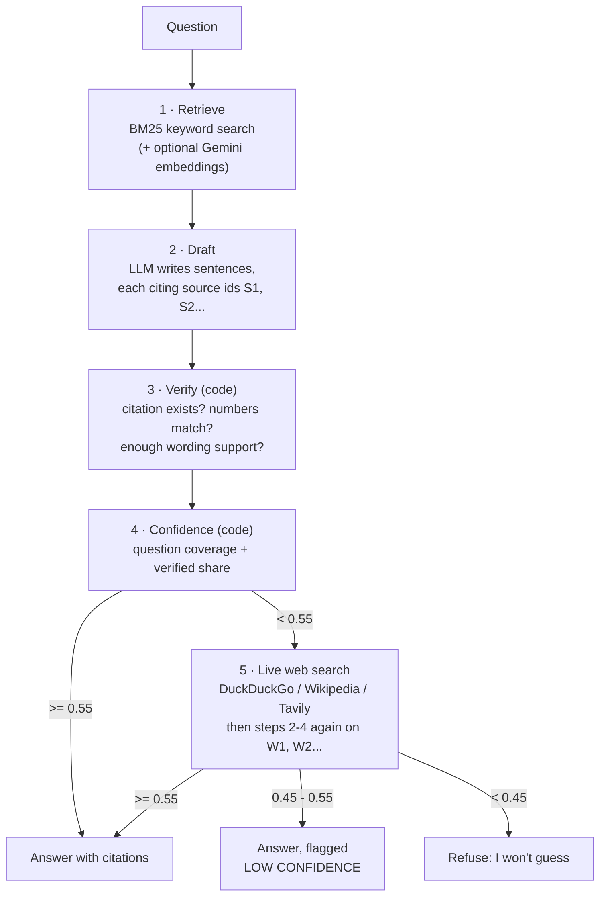

# Grounded RAG Agent

[](https://github.com/najahtasfiazumana-byte/grounded-rag-agent/actions/workflows/tests.yml)


A retrieval-augmented generation (RAG) agent that answers a sales team's questions from internal
documents, **with a citation on every sentence**. Code then **checks each sentence against the source it
cites**, **flags low-confidence answers**, **falls back to live web search** when the documents don't
have the answer, and **refuses to guess** when nothing reliable is found.

> **Why this matters for a GTM team:** sales reps ask the same policy questions all day (restocking
> fees, discount approvals, delivery times, renewal steps). A chatbot that confidently invents a 5%
> discount rule or a free accidental-damage cover creates real cost. This agent shows its sources, and
> code, not the model, decides what reaches the rep.

The knowledge base is the internal sales playbook of **Kiara Tech Solutions, a fictional Malaysian IT
reseller** (warranty, delivery, payment terms, discount approvals, M365 renewals, product catalog,
onboarding, support). All company data is invented.

---

## What it does

```
$ rag-agent ask "What is the restocking fee for opened items?"

✅ Answered · confidence 1.00 (high) · source: knowledge base

Opened items that are not faulty can be returned within 14 days of delivery but carry a 15% restocking fee. [1]

Sources
1. Warranty and Returns Policy › Returns and restocking fee (warranty_and_returns#returns-and-restocking-fee)
```

| Question | What happens |
|---|---|
| *"Which laptop should we recommend for a graphic designer?"* | Answered from the catalog, cited |
| *"When did Windows 10 reach end of support?"* | Not in the playbook, so it **falls back to web search** and cites the URL |
| *"Who needs to approve a 12% discount?"* (offline mode) | Evidence only partly covers it, so it's **flagged low confidence** |
| *"What discount did we give Syarikat Maju Jaya last March?"* | Private data nobody documented: **"I won't guess"** |

**The citation check catching a hallucination** ([`examples/guardrail_demo.md`](examples/guardrail_demo.md)):
a model drafted three sentences about the extended warranty; two were invented.

```
Removed by the citation check
- It also includes free accidental damage cover for 24 months.
    (number(s) not in the cited source: 24; only 43% of its key words appear in the cited source)
- The extended warranty costs 5% for orders above MYR 50,000.
    (number(s) not in the cited source: 5%, 50000; only 43% of its key words appear in the cited source)
```

## How it works



**The principle: the LLM reads and writes, code decides.** The model never grades itself:

| Guardrail | Rule (all in code, all configurable in `config.yaml`) |
|---|---|
| **Citation required** | Every sentence must cite a source id the agent actually provided. Missing or made-up ids are rejected. |
| **Number check** | Every number in a sentence (price, %, days) must appear in its cited source. `15%` and `15` are different facts; `MYR 3,000` = `3000`. |
| **Wording support** | At least 50% of the sentence's key words must appear in the cited source. |
| **Question coverage** | The best single cited source must cover the question's key words, weighted by rarity (IDF). Two unrelated sources can't add up to a confident answer. |
| **Confidence gate** | `0.6 × coverage + 0.4 × verified share`. Below 0.55: web fallback. Below 0.45 after fallback: refuse. In between: answer with a ⚠️ flag. |
| **Audit trail** | Every question is logged to `outputs/audit.jsonl` with status, confidence and the exact sources cited. |

Unsupported sentences are not silently dropped. They are listed under *"Removed by the citation check"*
with the reason, so a reviewer can see what the model tried to say.

More detail and design decisions: [`docs/ARCHITECTURE.md`](docs/ARCHITECTURE.md).

## Does it actually reduce hallucinations? The eval

`rag-agent eval` runs 25 questions through two pipelines with the **same model and retrieval**:

- **Naive RAG:** retrieve, answer, show everything (a typical first RAG demo)
- **Grounded agent:** citation check, confidence gate, web fallback, refusal

The questions are 16 answerable from the playbook, 3 only on the web, and 6 that nobody should answer
(private or non-existent data). An answer counts as **hallucinated** when it is shown *without* a
low-confidence flag and is wrong, unsupported, or answers an unanswerable question.

Offline run (mock model + fixture web search, from [`examples/eval_report.md`](examples/eval_report.md)):

| Metric | Naive RAG | Grounded agent |
|---|---:|---:|
| **Hallucinated answers shown** (lower is better) | 40% | **4%** |
| Knowledge-base questions answered correctly | 94% | 94% |
| ...and citing the right document | 100% | 100% |
| Web-only questions answered correctly (via fallback) | 0% | 67% |
| Unanswerable questions refused or flagged | 0% | 100% |

> ⚠️ The offline mock model copies source sentences, so these numbers prove the pipeline works rather
> than measure a real model. To measure with Gemini, run `rag-agent eval --provider gemini --web ddgs`.
> It writes `outputs/eval/eval_report.md`. Real-model numbers will differ; report the ones you get.
> If a question hits a model error (free-tier rate limit, timeout) it is marked `error` for **both**
> pipelines and left out of every rate, so a quota problem can never look like a safe refusal. The
> report says so at the top; re-run until it has no errors before quoting the numbers.

## Quick start

Needs Python 3.10+. No API key needed to try it.

```bash
git clone https://github.com/najahtasfiazumana-byte/grounded-rag-agent.git
cd grounded-rag-agent
pip install -e ".[dev,ui,pdf]"

rag-agent demo          # offline: sample answers + eval, written to examples/
pytest                  # 47 tests, offline
streamlit run app.py    # the web app
```

With a free Gemini key ([aistudio.google.com/apikey](https://aistudio.google.com/apikey)):

```bash
cp .env.example .env    # then paste your key after GEMINI_API_KEY=
rag-agent ask "When should the M365 renewal quote be sent?" --trace
rag-agent ask "When did Windows 10 reach end of support?"        # web fallback (DuckDuckGo, no key)
rag-agent eval --provider gemini --web ddgs                       # ~60 Gemini calls, 10-15 min
```

Step-by-step setup for Windows, Anaconda and VS Code: [`docs/SETUP.md`](docs/SETUP.md).

### Use your own documents

Put `.md`, `.txt` or `.pdf` files in a folder and point `paths.kb` in `config.yaml` at it (or run
`rag-agent ingest --kb path/to/folder`). Markdown is split on headings, so each citation points to a
section a person can open. Add your team's jargon to `data/glossary.yaml` (`m365: [microsoft 365]`).

Optional hybrid search: `rag-agent ingest --embeddings gemini` adds Gemini embeddings
(`gemini-embedding-001`) and merges them with BM25 using Reciprocal Rank Fusion.

## Commands

| Command | What it does |
|---|---|
| `rag-agent ingest [--kb DIR] [--embeddings none\|gemini]` | Build the index (`outputs/index.json`) |
| `rag-agent ask "..." [--trace] [--json]` | Answer one question; `--trace` shows every step and its timing |
| `rag-agent eval [--provider gemini] [--web ddgs] [--delay 4]` | Naive vs grounded comparison with a progress line per question, writes `outputs/eval/` |
| `rag-agent demo` | Offline run, writes `examples/` |
| `python scripts/guardrail_demo.py` | Shows the citation check removing invented sentences |
| `python scripts/check_gemini.py` | Checks which Gemini models your key can use |

Common flags: `--provider gemini|claude|ollama|mock`, `--web ddgs|wikipedia|tavily|mock|none`,
`--no-web`, `--top-k N`.

## Everything is free

| Part | Free option used |
|---|---|
| LLM | Gemini free tier (default `gemini-3.6-flash`), or Ollama locally, or the offline mock |
| Search over documents | BM25 in plain Python: no vector database, no paid embeddings |
| Embeddings (optional) | Gemini `gemini-embedding-001`, free tier |
| Web fallback | DuckDuckGo via `ddgs` (no key) or Wikipedia API (no key); Tavily free tier optional |
| UI | Streamlit (Community Cloud is free) |
| CI | GitHub Actions, offline: no keys, no internet search |

Free-tier LLM providers may use prompts to improve their products, so only send non-confidential
documents to a free tier. The sample playbook is fictional for that reason.

## Project structure

```
src/grounded_rag/
  documents.py    load .md/.txt/.pdf, split by heading into citable chunks
  bm25.py         keyword ranking (BM25) in plain Python
  embeddings.py   optional Gemini embeddings + Reciprocal Rank Fusion
  index.py        build / save / load / search the index
  answer.py       draft answer with per-sentence citations (LLM, or offline extractive)
  verify.py       check every sentence against its cited source        <- the guardrail
  confidence.py   explainable confidence score                         <- the gate
  websearch.py    DuckDuckGo / Wikipedia / Tavily / offline fixtures
  agent.py        retrieve -> draft -> verify -> score -> fallback -> answer/flag/refuse
  evaluate.py     naive vs grounded evaluation
  llm.py          Gemini / Claude / Ollama / mock over plain HTTP
  cli.py          rag-agent command
app.py            Streamlit app: Ask, Knowledge base, Evaluation tabs
data/kb/          the fictional sales playbook (8 documents, 38 sections)
data/eval/        25 evaluation questions
data/glossary.yaml  team jargon -> document wording
examples/         committed sample outputs
tests/            47 offline tests
```

## Known limitations (and what I'd do next)

- **Lexical checks.** Verification and coverage compare words, not meaning. A heavy paraphrase can be
  wrongly rejected, and a sentence that only *mentions* the right term can pass (in the offline eval,
  *"What is DuitNow?"* is answered with a sentence that only names DuitNow as a payment method). Next
  step: add an LLM or NLI "does this source entail this sentence?" check for borderline sentences.
- **Single-source coverage** is deliberately strict. Questions that genuinely need two documents get
  flagged rather than answered confidently.
- **Web snippets are short.** The fallback cites search-result snippets, not full pages. Next step:
  fetch and chunk the top page.
- **Offline mode can't reason.** It copies sentences, so it can't infer that a 12% discount falls
  under "above 10%". It flags that answer instead, which is the intended behaviour.

## Related projects

Part of a set of GTM automation prototypes:
[quote-agent](https://github.com/najahtasfiazumana-byte/quote-agent) (request-to-quote with HubSpot) ·
[renewal-radar](https://github.com/najahtasfiazumana-byte/renewal-radar) (Zoho renewals and upsell) ·
[deal-followthrough](https://github.com/najahtasfiazumana-byte/deal-followthrough) (post-sale follow-up and CRM hygiene).

## License

MIT. All companies, people and policies in `data/` are fictional.
